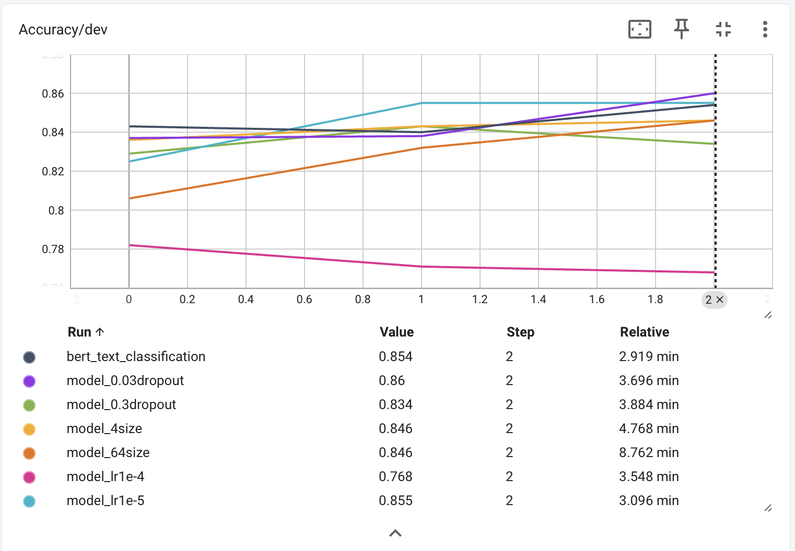
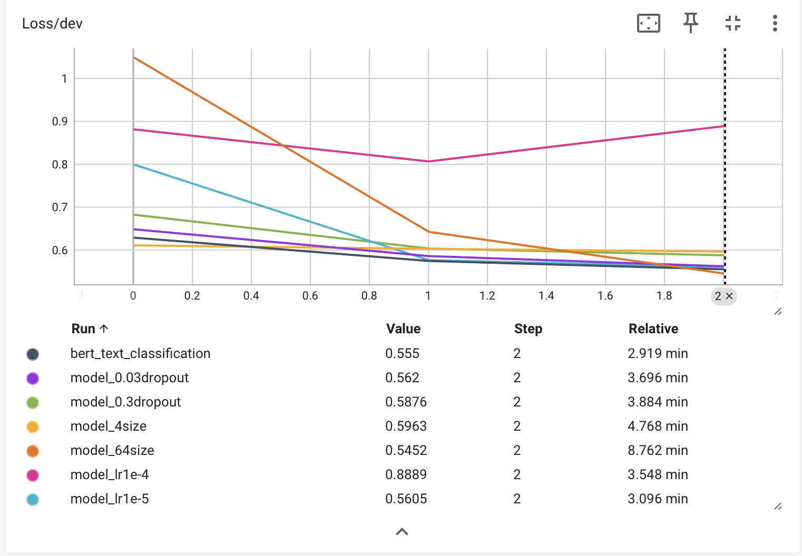
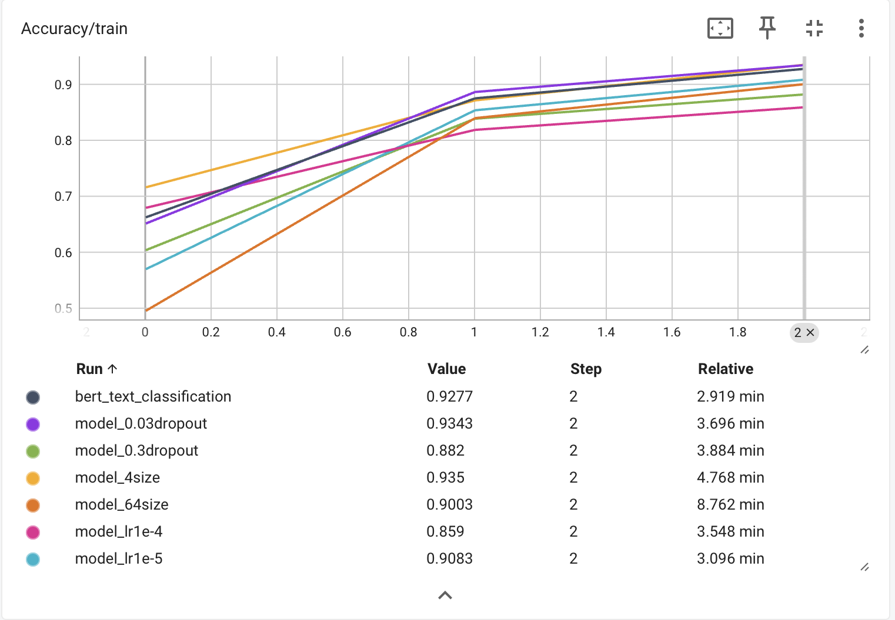
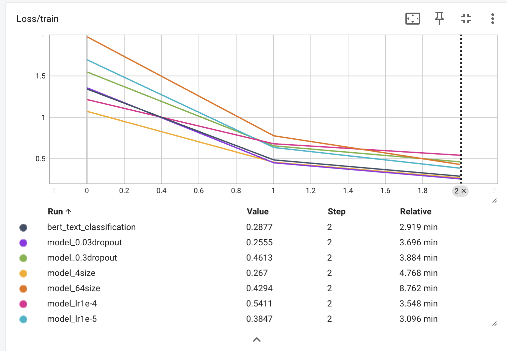

# Demo 1 · 基于 BERT 的中文新闻文本分类

用 `bert-base-chinese` 对今日头条中文新闻做 **15 类文本分类**，并以控制变量法对比
**Learning Rate / Batch Size / Hidden Dropout** 三组超参数对训练过程与验证集表现的影响。
7 组实验共用同一套代码，只通过 `config.json` 切换参数。



- 任务：中文新闻标题 + 关键词分类（今日头条数据集，15 类）
- 模型：`bert-base-chinese` + 线性分类头
- 框架：PyTorch（数据读取、`Dataset` / `DataLoader`、训练循环、指标统计均手写）
- 配置：`config.json` 保存基线与 6 组对照实验，训练 / 测试统一用 `--exp` 选择
- 可视化：`torch.utils.tensorboard.SummaryWriter`（TensorBoard）
- 基线结果：**Dev Accuracy 85.40%，Train Accuracy 92.77%，Test Accuracy 84.40%**
  （通过 83% 参考指标）

> 本项目改用 PyTorch 自带的 `SummaryWriter` + TensorBoard
> 完成"训练过程与结果可视化"，未使用 `transformers.Trainer`、`datasets`、`scikit-learn`、
> `matplotlib` 或 SwanLab。

## 目录结构

```text
0.demo1文本分类/
├── README.md                    # 本文件
├── requirements.txt             # 依赖
├── config.json                  # 唯一配置源：defaults + experiments
├── label_map.json               # 15 类 label_id -> 连续 id 的映射
├── .gitignore
├── data/                        # 数据集
│   ├── train_3k.txt             # 训练集 3000 条
│   ├── dev_1k.txt               # 验证集 1000 条
│   ├── test_1k.txt              # 测试集 1064 条
│   └── README.md                # 数据格式、类别与分布
├── src/                         # 源码
│   ├── config.py                # 读取 config.json，解析路径
│   ├── dataset.py               # NewsDataset：读文件、拼标题+关键词、tokenize
│   ├── model.py                 # 加载 bert-base-chinese，设置类别与 dropout
│   ├── trainer.py               # 训练/验证循环、TensorBoard、保存最优 checkpoint
│   ├── train.py                 # 训练入口
│   └── test.py                  # 测试入口
├── scripts/
│   └── run_experiments.sh       # 依次跑完 6 组对照实验
├── checkpoints/                 # 权重文件（*.pth 已 gitignore，仅 README 入库）
│   └── README.md
├── runs/                        # TensorBoard 日志（已 gitignore）
├── results/                     # 实验图表（入库，供报告引用）
│   ├── figures/                 # 7 组实验的对比曲线
│   ├── screenshots/             # 单次运行的终端 / TensorBoard 截图
│   └── README.md
└── docs/
    └── 任务要求.png              # 课程题目原文截图
```

代码、配置、数据、图表与文档彼此分离；权重和 TensorBoard 日志体积大，用 `.gitignore`
排除，仓库只保留**可复现的源码、配置、数据、图表和文档**。

## 环境准备

```bash
conda activate learn-pytorch     # Python 3.10+ 环境
pip install -r requirements.txt
```

实测环境：Python 3.13.14 / torch 2.12.1 / transformers 5.12.1 / tensorboard 2.21.0，
Apple Silicon（MPS 可用）。

`config.json` 中 `"local_files_only": true`，脚本不会联网下载模型，因此**首次使用前需要先把
`bert-base-chinese` 下载到本地缓存**：

```bash
python -c "from transformers import AutoTokenizer, AutoModelForSequenceClassification; \
AutoTokenizer.from_pretrained('bert-base-chinese'); \
AutoModelForSequenceClassification.from_pretrained('bert-base-chinese')"
```

## 快速开始

所有命令都在项目根目录执行（脚本内部按 `__file__` 定位路径，不依赖当前工作目录）。

```bash
# 1. 基线训练（lr=2e-5, batch_size=16, hidden_dropout=0.1，3 个 epoch）
python src/train.py --exp base

# 2. 用该实验对应的 checkpoint 在测试集上评估
python src/test.py --exp base

# 3. 查看训练曲线
tensorboard --logdir runs        # 浏览器打开 http://localhost:6006

# 4. 依次跑完 6 组超参数对照实验（耗时较长，每组约 3~10 分钟）
bash scripts/run_experiments.sh
```

`--exp` 的取值来自 `config.json` 的 `experiments`：

```text
base
exp_lr_1e-5
exp_lr_1e-4
exp_batch_4
exp_batch_64
exp_dropout_0.03
exp_dropout_0.3
```

也可以只跑其中一组：

```bash
python src/train.py --exp exp_dropout_0.03
python src/test.py  --exp exp_dropout_0.03
```

每次训练会：

1. 读取 `config.json`，把 `defaults` 与所选实验的覆盖项浅合并，并固定随机种子 `seed=42`；
2. 读取 `label_map.json`，得到 15 类的 `label2id`；
3. 读取 `data/` 下对应数据，把 `title + " " + keywords` 交给 tokenizer；
4. 用 `DataCollatorWithPadding` 做动态 padding，构造 `DataLoader`；
5. 微调 `bert-base-chinese`，每个 epoch 在验证集上评估；
6. 把 `Loss/train`、`Accuracy/train`、`Loss/dev`、`Accuracy/dev` 写入
   `runs/<run_name>/`，并按 **dev accuracy 最优**保存 checkpoint 到 `checkpoints/`。

## 配置说明

`config.json` 是项目唯一的配置源，分为两部分：

- `defaults`：基线配置；
- `experiments`：每组实验只写与基线不同的键，运行时与 `defaults` 浅合并。

所有路径都相对项目根目录，`src/config.py` 用 `Path(__file__).resolve().parents[1]`
解析，因此不依赖当前工作目录。`run_name` 对应 `runs/<run_name>`，
`checkpoint_name` 对应 `checkpoints/<checkpoint_name>`。

| 键 | 基线值 | 说明 |
| --- | --- | --- |
| `model_path` | `bert-base-chinese` | Hugging Face 模型名或本地路径 |
| `local_files_only` | `true` | 只读本地缓存，需提前下载模型 |
| `max_length` | `128` | 截断长度 |
| `dynamic_padding` | `true` | 按 batch 内最长样本 padding |
| `batch_size` | `16` | 训练 batch size |
| `eval_batch_size` | 未设置 | 仅验证集使用；`exp_batch_4` 设为 `16` |
| `epochs` | `3` | 训练轮数 |
| `lr` | `2e-5` | AdamW 学习率 |
| `seed` | `42` | Python / NumPy / PyTorch / MPS 随机种子 |
| `hidden_dropout_prob` | `0.1` | BERT hidden dropout |
| `attention_probs_dropout_prob` | `0.1` | BERT attention dropout |
| `classifier_dropout` | `0.1` | 分类头 dropout |
| `train_file` / `dev_file` / `test_file` | `data/...` | 三份数据 |
| `label_map_file` | `label_map.json` | 标签映射 |
| `checkpoint_dir` / `checkpoint_name` | `checkpoints` / `best_model.pth` | 权重输出 |
| `runs_dir` / `run_name` | `runs` / `bert_text_classification` | TensorBoard 输出 |

新增一组实验不需要改代码，只需在 `experiments` 里加一项，例如：

```json
"exp_lr_3e-5": {
  "lr": 3e-5,
  "run_name": "model_lr3e-5",
  "checkpoint_name": "best_model_3e-5.pth"
}
```

然后运行 `python src/train.py --exp exp_lr_3e-5` 即可。

模型结构：`bert-base-chinese` → `[CLS]` 隐状态 → Dropout → `Linear(768, 15)`，
损失函数为 `CrossEntropyLoss`，优化器为 `AdamW`。`exp_batch_64` 会额外开启
gradient checkpointing 以节省显存。

## 实验矩阵

基线为 `lr=2e-5`、`batch_size=16`、`hidden_dropout=0.1`；每组只改变一个参数。
`attention_probs_dropout_prob` 与 `classifier_dropout` 始终为 `0.1`。

| 实验组 | `--exp` | Learning Rate | Batch Size | Hidden Dropout | Dev batch | TensorBoard 目录 | 权重文件 |
| --- | --- | --- | --- | --- | --- | --- | --- |
| Baseline | `base` | 2e-5 | 16 | 0.1 | 16 | `runs/bert_text_classification` | `best_model.pth` |
| LR-1 | `exp_lr_1e-5` | 1e-5 | 16 | 0.1 | 16 | `runs/model_lr1e-5` | `best_model_1e-5.pth` |
| LR-2 | `exp_lr_1e-4` | 1e-4 | 16 | 0.1 | 16 | `runs/model_lr1e-4` | `best_model_1e-4.pth` |
| BS-1 | `exp_batch_4` | 2e-5 | 4 | 0.1 | 16 | `runs/model_4size` | `model_4size.pth` |
| BS-2 | `exp_batch_64` | 2e-5 | 64 | 0.1 | 64 | `runs/model_64size` | `best_model_64size.pth` |
| Dropout-1 | `exp_dropout_0.03` | 2e-5 | 16 | 0.03 | 16 | `runs/model_0.03dropout` | `model_0.03dropout.pth` |
| Dropout-2 | `exp_dropout_0.3` | 2e-5 | 16 | 0.3 | 16 | `runs/model_0.3dropout` | `model_0.3dropout.pth` |

## 实验结果

### 第 3 个 Epoch 的结果

下表取 TensorBoard 中 `Step = 2`（即第 3 个 epoch）的**原始 Value**，不是平滑后的
Smoothed 数值；`最佳 Dev Acc` 是该实验保存 checkpoint 时的验证集准确率。

| 实验 | 改变参数 | Train Acc | Train Loss | Dev Loss | Dev Acc | 最佳 Dev Acc（Epoch） |
| --- | --- | --- | --- | --- | --- | --- |
| **Baseline** | 默认 | 92.77% | 0.2877 | 0.5550 | **85.40%** | 85.40%（3） |
| LR=1e-5 | `lr=1e-5` | 90.83% | 0.3847 | 0.5605 | **85.50%** | 85.50%（2） |
| LR=1e-4 | `lr=1e-4` | 85.90% | 0.5411 | 0.8889 | 76.80% | 78.20%（1） |
| Batch Size=4 | `batch_size=4` | 93.50% | 0.2670 | 0.5963 | 84.60% | 84.60%（3） |
| Batch Size=64 | `batch_size=64` | 90.03% | 0.4294 | 0.5452 | 84.60% | 84.60%（3） |
| Dropout=0.03 | `hidden_dropout=0.03` | 93.43% | 0.2555 | 0.5620 | **86.00%** | 86.00%（3） |
| Dropout=0.3 | `hidden_dropout=0.3` | 88.20% | 0.4613 | 0.5876 | 83.40% | 84.30%（2） |

> `LR=1e-4` 从第 2 个 epoch 起 dev loss 回升、dev accuracy 下降，因此保存的是第 1 个
> epoch 的权重；`Dropout=0.3` 保存的是第 2 个 epoch 的权重。

### 测试集结果

用基线最优 checkpoint 在测试集（1064 条）上评估一次：

| 实验 | Checkpoint | Test Loss | Test Accuracy |
| --- | --- | --- | --- |
| Baseline | `checkpoints/best_model.pth` | 0.5871 | **84.40%** |

其余 6 组实验只报告验证集结果，没有单独跑测试集。

### 曲线

| 验证集准确率 | 验证集损失 |
| --- | --- |
|  |  |
| **训练集准确率** | **训练集损失** |
|  |  |

### 结论摘要

- **Learning Rate**：`1e-5` 与基线 `2e-5` 的最终 dev accuracy 为 85.50% / 85.40%，
  基本持平，但 `1e-5` 收敛更慢；`1e-4` 明显过大，dev accuracy 只有 76.80%
  （最佳 epoch 也只有 78.20%），train loss 继续下降而 dev loss 回升，是典型的过拟合 / 训练不稳定。
  因此在本任务上 `1e-5 ~ 2e-5` 是更稳妥的区间。
- **Batch Size**：固定 3 个 epoch 时，batch size 同时改变梯度批量大小与每轮
  `optimizer.step()` 次数。batch=4 与 batch=64 的 dev accuracy 都是 84.60%，低于基线的
  85.40%；batch=4 的 train acc 最高（93.50%）但 dev loss 也偏高，batch=64 每轮只有
  47 次参数更新、train acc 仅 90.03%，更可能是训练不充分。基线 16 最平衡。
- **Hidden Dropout**：0.03 时正则化偏弱，train acc 最高（93.43%），dev acc 也最高（86.00%）；
  0.3 时正则化过强，train acc 只有 88.20%，最终 dev acc 降到 83.40%；0.1 居中（85.40%）。
  0.03 与 0.1 只差 0.6 个百分点，在单次运行下不足以断定优劣，0.1 仍是更稳妥的默认值。
- **总体**：train accuracy 不能单独作为模型优劣依据，需要同时看 train loss、dev loss 和
  dev accuracy；本次基线测试集准确率 84.40%，通过 83% 的参考指标。

## 已知问题与局限

1. **每组只跑了一次、只用一个随机种子**：分类头初始化、dropout 和 MPS 算子都会带来波动，
   0.1~1 个百分点的差距不宜解读为确定优劣。更严格的做法是固定多个种子重复实验，报告均值与标准差。
2. **只训练 3 个 epoch**：batch=64 时每轮只有 47 次更新，可能尚未充分收敛；后续可对比
   "固定 epoch" 与 "固定 optimizer step" 两种实验设计。
3. **只统计 accuracy**：没有 per-class precision / recall / F1 和混淆矩阵。数据存在类别不平衡
   （训练集中 `114` 类 40 条、`100` 类 49 条，`109` 类 322 条），单看 accuracy 可能掩盖少数类问题。
4. **`test_1k.txt` 实际是 1064 条**：文件名沿用历史命名，见 `data/README.md`。
5. **模型只从本地缓存加载**：`local_files_only=true` 时若缓存中没有 `bert-base-chinese`，
   脚本会直接报错，需要先按"环境准备"下载一次。

## 相关文档

| 文件 | 说明 |
| --- | --- |
| [`docs/任务要求.png`](docs/任务要求.png) | 课程题目原文截图（含 83% 参考指标的要求） |
| [`data/README.md`](data/README.md) | 数据格式、字段、类别与分布 |
| [`results/README.md`](results/README.md) | 图表与截图清单、读图注意事项 |
| [`checkpoints/README.md`](checkpoints/README.md) | 权重文件说明、加载方式与复现命令 |

## 数据来源

原始数据来自 [今日头条文本分类数据集](https://github.com/aceimnorstuvwxz/toutiao-text-classfication-dataset)，
本项目使用其中的 15 类新闻标题与关键词，并划分为 3000 / 1000 / 1064 条。
